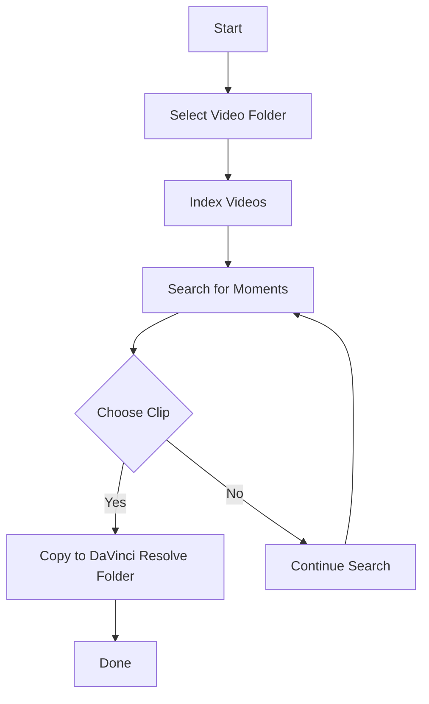

# ClipSorter

## How it Works
ClipSorter is a local tool that indexes your video files using open‑source ML models, allowing you to search for interesting moments (e.g., cycling highlights) and automatically send the selected clips to your DaVinci Resolve timeline.

### Workflow
1. **Indexing** – The system scans a folder of video files, extracts frames, and runs a lightweight object‑detection model (YOLOv8) to identify cycling‑related activity.
2. **Search & Selection** – You can query by keywords, timestamps, or visual tags. The best clips are ranked and previewed.
3. **Export** – Selected clips are copied to a designated folder that DaVinci Resolve monitors, making them instantly available in the timeline.

### Technologies
- **Hardware**: M1 Max (Apple Silicon) or any modern CPU/GPU.
- **ML Models**: YOLOv8 (object detection) + CLIP for semantic search.
- **Backend**: Python FastAPI server for API endpoints.
- **Frontend**: CLI tool built with Typer.

### Benefits
- **Privacy**: All processing stays local; no cloud upload.
- **Speed**: M1 Max accelerates frame extraction and inference.
- **Customization**: Tune the thinking effort (low/medium/high) to balance latency vs. accuracy.

