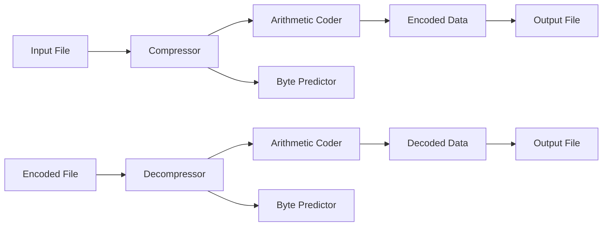

# CodeCompress

## Overview
CodeCompress is a lightweight, efficient file compression utility that uses arithmetic coding and a simple byte prediction model. It is designed to compress text-based files, such as source code, to reduce their size for storage or transmission.

## Architecture
The project is structured into several key components:
- **Arithmetic Coder**: Implements the arithmetic coding algorithm.
- **Byte Predictor**: Develops a simple byte prediction model.
- **Compressor**: Integrates the prediction model with the arithmetic coder to compress and decompress files.
- **Tests**: Unit tests and integration tests to ensure the system works as expected.

### High-Level Architecture Diagram


## How it Works
1. **Byte Prediction**:
   - The `byte_predictor` module predicts the next byte in a sequence based on the frequency of the last few bytes using a simple Markov model.
   - This prediction is used to update the probabilities of each symbol (byte).

2. **Arithmetic Coding**:
   - The `arithmetic_coder` module encodes the message using arithmetic coding, which is a form of entropy encoding.
   - The encoded data is then written to an output file.

3. **Compression and Decompression**:
   - The `compressor` module integrates the byte predictor and arithmetic coder to compress and decompress files.
   - During compression, the input file is read, and the data is encoded using the updated probabilities.
   - During decompression, the encoded data is read, and the original message is reconstructed.

## Setup Instructions
### Dependencies
- Python 3.8 or higher
- `pytest` for running tests

### Installation
1. Clone the repository:
   ```sh
   git clone https://github.com/yourusername/CodeCompress.git
   cd CodeCompress
   ```

2. Create and activate a virtual environment (optional but recommended):
   ```sh
   python -m venv venv
   source venv/bin/activate  # On Windows: venv\Scripts\activate
   ```

3. Install the required dependencies:
   ```sh
   pip install pytest
   ```

## Usage
### Compressing a File
To compress a file, use the following command:
```sh
python -m compressor.compress_file <input_path> <output_path>
```
- `<input_path>`: Path to the file you want to compress.
- `<output_path>`: Path where the compressed data will be written.

### Decompressing a File
To decompress a file, use the following command:
```sh
python -m compressor.decompress_file <input_path> <output_path> <length>
```
- `<input_path>`: Path to the compressed file.
- `<output_path>`: Path where the decompressed data will be written.
- `<length>`: Length of the original message.

## Running Tests
To run the tests, use the following command:
```sh
pytest test_main.py
```

## Contributing
Contributions are welcome! Please follow the style guide and rules mentioned in the `README.md`.

## License
This project is licensed under the MIT License. See the `LICENSE` file for details.