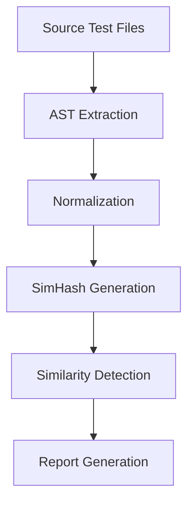

# CodeGuard

**CodeGuard** is a lightweight, zero‑dependency tool that automatically detects duplicated or nearly‑duplicate test cases in a Python codebase. By parsing the test suite, normalizing test logic into a canonical representation, and applying SimHash similarity hashing, it flags potential redundancy with confidence scores, helping teams keep their tests maintainable and efficient.

---

## Table of Contents

- [Purpose](#purpose)
- [Architecture](#architecture)
- [How it Works](#how-it-works)
- [Installation](#installation)
- [Usage](#usage)
- [Testing](#testing)
- [Limitations](#limitations)
- [License](#license)

---

## Purpose

Maintaining a large test suite can quickly become unwieldy when duplicate or near‑duplicate tests exist. CodeGuard automatically scans your tests, identifies similarities, and reports them so you can refactor or remove redundant cases, saving time and reducing maintenance overhead.

---

## Architecture

1. **AST Extraction** – Parses each test file into an Abstract Syntax Tree (AST) and extracts all test functions.
2. **Normalization** – Converts assertions, test data, and control flow into a canonical form that removes superficial differences (e.g., variable names, literals).
3. **SimHash** – Generates a compact fingerprint for each canonical test representation.
4. **Similarity Detection** – Computes Hamming distances between SimHashes to group tests with high similarity scores.

---

## How it Works



1. **AST Extraction**: `TestExtractor` walks the AST of each file, collecting function definitions that start with `test_`.
2. **Normalization**: `PlaceholderTransformer` replaces literals and variable names with placeholders, producing a deterministic string representation.
3. **SimHash**: The canonical string is hashed using the SimHash algorithm, producing a 64‑bit fingerprint.
4. **Similarity Detection**: `group_similar_tests` compares fingerprints; tests with a Hamming distance below a configurable threshold are considered duplicates.
5. **Report**: A human‑readable table is printed to stdout, and JSON output is available via `--json`.

---

## Installation

```bash
# Install from source
pip install .

# Or, if you only need the SimHash dependency
pip install simhash
```

> CodeGuard is pure Python and has no external dependencies beyond the standard library and the optional `simhash` package.

---

## Usage

```bash
# Scan a directory of tests
python -m codeguard path/to/tests

# Scan and output JSON
python -m codeguard path/to/tests --json
```

### Command Line Options

| Option | Description |
|--------|-------------|
| `--json` | Output the report in JSON format |
| `--threshold N` | Minimum similarity score (default 3) |
| `--exclude PATTERN` | Exclude files matching the glob pattern |
| `--help` | Show help message |

---

## Testing

CodeGuard comes with a comprehensive test suite.

```bash
# Run all tests
pytest

# Run a specific test file
pytest test_codeguard.py
```

The tests cover:

- AST extraction accuracy
- Normalization correctness
- SimHash distance calculations
- CLI behavior (exit codes, JSON output)
- Performance benchmarks for large test suites

---

## Limitations

- **Python Only**: Currently supports only Python test files (`.py`).
- **Simple Similarity**: Relies on SimHash; may miss deeper semantic similarities or catch false positives for highly similar but functionally different tests.
- **No External APIs**: Operates entirely locally; no network calls or external services are required.
- **Limited Assertion Support**: Handles common assertion patterns but may not normalize custom assertion libraries or complex data structures.

---

## License

MIT License – see the [LICENSE](LICENSE) file for details.