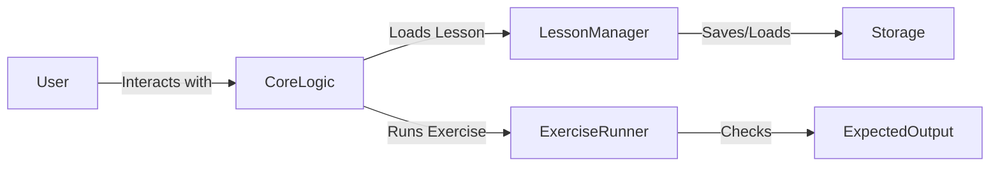

# CodeTutor

## Vision
CodeTutor is a local, interactive, and self-contained learning environment for developers to learn new programming concepts and languages using an LLM-driven tutor. The tutor provides interactive lessons, code examples, and exercises, all while running on the user's local machine.

## Architecture
### Components
- **Core Logic (`core_logic.py`)**: Contains the `Lesson` class, `load_lesson` function, and `CoreLogic` class which handles the core logic of the application.
- **Lesson Manager (`lesson_manager.py`)**: Manages the loading, saving, and navigation of lessons.
- **Exercise Runner (`exercise_runner.py`)**: Runs and checks user-submitted code against expected outputs.
- **Testing (`test_main.py`)**: Unit and integration tests for the core components.

### How it Works
1. **Setup**: The user sets up the environment and loads the initial lesson.
2. **Interactive Lessons**: The user interacts with the LLM-driven tutor, which provides context and responses based on the current lesson.
3. **Exercises**: The user completes exercises, and the `ExerciseRunner` checks the solutions.
4. **Feedback Loop**: The user receives feedback on their solutions and can move to the next lesson or exercise.

### Diagram


## Setup Instructions
1. Clone the repository:
   ```sh
   git clone https://github.com/your-repo/CodeTutor.git
   cd CodeTutor
   ```

2. Create a virtual environment and install dependencies:
   ```sh
   python -m venv venv
   source venv/bin/activate  # On Windows use `venv\Scripts\activate`
   pip install -r requirements.txt
   ```

3. Set up the storage file (e.g., `lessons.json`):
   ```json
   [
       {
           "title": "Introduction to Python",
           "content": "Welcome to the Python tutorial. In this lesson, you will learn the basics of Python.",
           "exercises": []
       }
   ]
   ```

4. Run the application:
   ```sh
   python main.py
   ```

## Running Tests
To run the tests, use the following command:
```sh
python -m unittest test_main.py
```

This will execute the unit and integration tests defined in `test_main.py`.