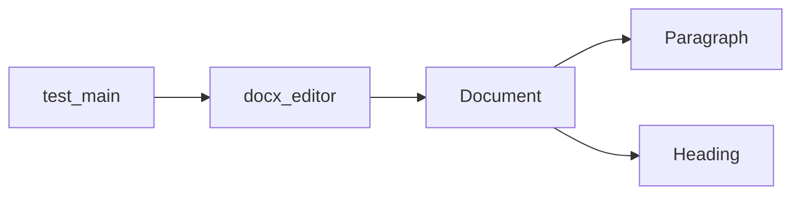

# DocxEditorLite

## Vision
DocxEditorLite is a lightweight, cross-platform DOCX editor that allows users to create, edit, and save DOCX files without the need for heavy dependencies or external APIs. The project focuses on providing a minimalistic, yet functional, solution for basic document editing needs.

## Architecture
The architecture of DocxEditorLite is designed to be simple and modular. Here's a breakdown of the key components:

- **Document**: Represents the entire document and contains methods to add, remove, and manage content.
- **Paragraph and Heading**: These classes represent individual paragraphs and headings within the document.
- **docx_editor.py**: Contains the main functions for loading, saving, and modifying the document.
- **test_main.py**: Contains unit tests to ensure the functionality of the editor.

### Diagram


## Installation
To install and run DocxEditorLite, follow these steps:

1. Clone the repository:
   ```sh
   git clone https://github.com/yourusername/DocxEditorLite.git
   cd DocxEditorLite
   ```

2. Install the required dependencies:
   ```sh
   pip install -r requirements.txt
   ```

3. Run the tests to ensure everything is working correctly:
   ```sh
   python -m unittest discover
   ```

4. Use the `docx_editor.py` module in your Python scripts to load, edit, and save DOCX documents.

## How It Works
### Loading a Document
To load a DOCX document, use the `load_document` function from `docx_editor.py`. This function takes a file path as an argument and returns a `Document` object.

```python
from docx_editor import load_document

document = load_document('path/to/document.docx')
```

### Adding Content
You can add paragraphs and headings to the document using the `add_paragraph` and `add_heading` functions.

```python
from docx_editor import add_paragraph, add_heading

add_paragraph(document, "This is a new paragraph.")
add_heading(document, "New Heading", 1)
```

### Saving a Document
To save the modified document, use the `save_document` function. This function takes the `Document` object and the file path where you want to save the document.

```python
from docx_editor import save_document

save_document(document, 'path/to/saved_document.docx')
```

## Testing
The `test_main.py` file contains unit tests to ensure the functionality of the editor. You can run the tests using the following command:

```sh
python -m unittest discover
```

## Contributing
Contributions are welcome! Please read the [contribution guidelines](CONTRIBUTING.md) before submitting a pull request.

## License
This project is licensed under the MIT License. See the [LICENSE](LICENSE) file for details.