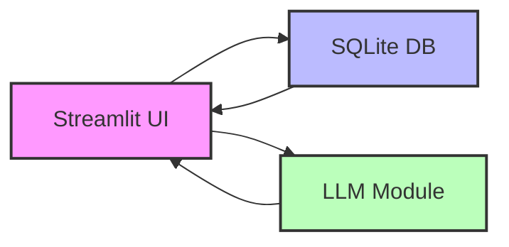

# InsightPulse – Local AI‑Powered Business IT‑Issue Tracker

## Project Overview
InsightPulse is a compact, privacy‑first web application that enables small‑to‑medium businesses to log, classify, and visualize recent IT incidents. By leveraging a locally‑run Large Language Model (LLM), the app automatically tags tickets and suggests possible root causes, turning noisy support logs into actionable insights without sending any data to external APIs.

## Features
- **Local LLM Tagging & Root‑Cause Suggestions** – Uses a downloadable open‑source model (e.g., Mistral‑7B‑Instruct) to generate smart tags and diagnostic hints.
- **Incident CRUD** – Create, read, update, and delete IT incident records through a clean Streamlit UI.
- **Trend Charts & Analytics** – Interactive visualizations of incident frequency, tag distribution, and affected services over selectable time windows.
- **Export CSV** – Download the full incident database for offline analysis or reporting.
- **Privacy‑First** – All processing runs on‑premise; no third‑party API calls.

## Prerequisites
- Python **3.10** or newer
- `pip` (compatible with your Python version)
- A compatible local LLM model (e.g., `mistralai/Mistral-7B-Instruct-v0.2`)
- Optional: NVIDIA GPU with CUDA for faster inference (CPU fallback is supported)

## Setup
```bash
# 1. Clone the repository
git clone https://github.com/yourusername/insightpulse.git
cd insightpulse

# 2. Create and activate a virtual environment
python -m venv venv
source venv/bin/activate   # On Windows use `venv\Scripts\activate`

# 3. Install Python dependencies
pip install -r requirements.txt

# 4. Download the LLM model into the `models/` directory
#    (requires huggingface_hub and transformers)
mkdir -p models
transformers-cli download mistralai/Mistral-7B-Instruct-v0.2 --cache-dir models

# 5. Run the application
streamlit run app.py
```

## How it Works
1. **User Input** – An incident is entered via the Streamlit form (title, description, affected service, severity, etc.).
2. **LLM Module** – The description is sent to the locally loaded LLM, which returns:
   - A set of inferred tags (e.g., *network*, *authentication*, *outage*).
   - A short root‑cause hypothesis.
3. **Database Layer** – The incident record, together with the generated metadata, is persisted in a SQLite database (`data/incidents.db`).
4. **Analytics Engine** – Queries aggregate the stored data; results are fed back to Streamlit for real‑time charts.
5. **Export** – Users can download the entire SQLite table as a CSV file for external reporting.

## Usage
### Main Dashboard


- **Add Incident** – Click the “New Incident” button, fill the form, and submit. Tags and suggestions appear automatically.
- **Incident List** – Browse, edit, or delete entries in the table view.
- **Analytics** – Switch to the “Analytics” tab to see:
  - Incident count per week/month
  - Tag frequency heatmap
  - Service‑wise severity distribution

### Exporting Data
1. Navigate to the **Export** tab.
2. Click **Download CSV** – a `incidents_YYYYMMDD.csv` file is generated.

## Architecture Diagram


## Testing
```bash
# Run the test suite
pytest
```
Tests cover model loading, tagging logic, database CRUD operations, and Streamlit component rendering.

## License
This project is licensed under the **MIT License** – see the `LICENSE` file for details.