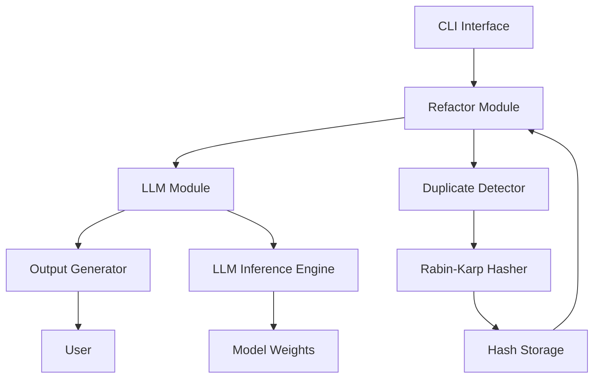

# Local Duplicate Code Detector & Refactor Assistant (LDCDRA)

A lightweight, fully local tool that scans codebases, identifies duplicate code blocks using memory-efficient hashing, and leverages an open-source LLM to generate refactoring suggestions and test stubs—without external APIs or large datasets.

## Motivation

Code duplication is a significant source of technical debt, leading to maintenance nightmares and increased bug risks. Traditional duplicate detection tools often rely on heavyweight algorithms or require cloud-based services, which are resource-intensive and raise privacy concerns. LDCDRA addresses these challenges by:

- **Memory Efficiency**: Utilizing rolling hash algorithms (e.g., Rabin-Karp) to detect duplicates with minimal memory overhead, enabling analysis of large codebases on resource-constrained systems.
- **Local Processing**: Running entirely on-device, ensuring data privacy and eliminating dependency on external APIs.
- **AI-Powered Refactoring**: Integrating a local open-source LLM (e.g., Llama-2-7B-Chat) to provide actionable refactoring suggestions and auto-generated test stubs, reducing manual effort.

## Prerequisites

- Python 3.10 or higher
- `pip` package manager
- Git (for cloning repositories)
- At least 10GB of free disk space (for LLM weights)

## Setup

1. **Clone the Repository**:
   ```bash
   git clone https://github.com/example/ldcdra.git
   cd ldcdra
   ```

2. **Create a Virtual Environment**:
   ```bash
   python -m venv venv
   source venv/bin/activate  # On Windows: venv\Scripts\activate
   ```

3. **Install Dependencies**:
   ```bash
   pip install -r requirements.txt
   ```

4. **Download the Local LLM**:
   - Download a quantized Llama-2-7B-Chat model (e.g., `llama-2-7b-chat.ggml.q4_0.bin`) from [TheBloke's Hugging Face page](https://huggingface.co/TheBloke/Llama-2-7B-Chat-GGUF).
   - Place the model file in the `models/` directory.

## Usage Examples

### Detect Duplicates
Scan a codebase for duplicate code blocks:
```bash
python main.py detect --path src/
```

### Suggest Refactorings
Generate refactoring suggestions for identified duplicates:
```bash
python main.py refactor --path src/
```

### AI Code Review
Perform an AI-powered code review with refactoring recommendations:
```bash
python main.py review --path src/
```

## Architecture

The following diagram illustrates the flow of the LDCDRA system:



## How It Works

1. **Duplicate Detection**:
   - The `DuplicateDetector` class uses a rolling hash algorithm (Rabin-Karp) to compute hashes for code blocks.
   - Hashes are stored in a memory-efficient dictionary, allowing O(1) lookups for duplicates.
   - The detector scans files in the specified path, extracts code blocks, and identifies duplicates based on hash matches.

2. **Refactoring Suggestions**:
   - The `RefactorModule` processes detected duplicates and prepares prompts for the LLM.
   - The `LLMModule` loads the quantized Llama-2 model and generates refactoring suggestions using the Hugging Face Transformers library.
   - Suggestions include extracting methods, creating helper functions, or consolidating repeated logic.

3. **AI Code Review**:
   - The `ReviewModule` combines duplicate detection and refactoring suggestions.
   - It outputs a structured report with code locations, duplicate details, and AI-generated recommendations.

4. **Local LLM Integration**:
   - The LLM runs locally using `llama.cpp` or similar libraries, ensuring no data leaves the user's machine.
   - Prompts are dynamically generated based on code context, ensuring relevance and accuracy.

## Contribution Guidelines

We welcome contributions! Please follow these steps:

1. Fork the repository and create a feature branch.
2. Ensure your code adheres to the project's style guide (PEP 8 for Python).
3. Add unit tests for new functionality.
4. Submit a pull request with a clear description of changes.

## License

This project is licensed under the MIT License. See the [LICENSE](LICENSE) file for details.

EOF## Contributing

We welcome contributions! Here's how you can help:

1. Fork the repository
2. Create a feature branch (`git checkout -b feature/AmazingFeature`)
3. Commit your changes (`git commit -m 'Add some AmazingFeature'`)
4. Push to the branch (`git push origin feature/AmazingFeature`)
5. Open a Pull Request

### Development Setup

1. Clone the repository
2. Install dependencies: `pip install -r requirements.txt`
3. Run tests: `pytest`
4. Make your changes
5. Ensure your code adheres to the project's style guide (PEP 8 for Python).
6. Add unit tests for new functionality.
7. Submit a pull request with a clear description of changes.

## License

This project is licensed under the MIT License. See the [LICENSE](LICENSE) file for details.

## Contact

Project Maintainer: [Your Name](https://github.com/yourusername)  
Email: your.email@example.com  
Project Link: [https://github.com/yourusername/project-name](https://github.com/yourusername/project-name)

## Acknowledgments

- Inspiration from the open-source community
- Libraries and frameworks that made this project possible
- All contributors who have helped shape this project