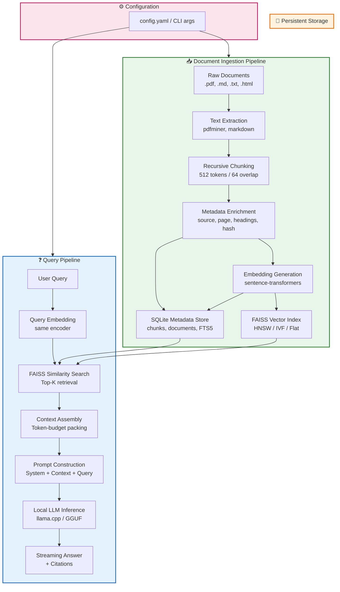

# LocalAI Knowledge Hub

**Your Private, Offline-First Personal Knowledge Assistant**

---

## Overview

LocalAI Knowledge Hub is a lightweight, privacy-preserving personal knowledge assistant that indexes your documents locally and uses a local Large Language Model (LLM) to answer natural language queries. **Zero cloud dependencies. Zero telemetry. Your data never leaves your machine.**

### Privacy Guarantees

- **100% Local Execution**: All embedding, indexing, and inference runs on your hardware.
- **No Network Calls**: The application does not make any outbound HTTP requests unless you explicitly configure a remote model endpoint.
- **Data Sovereignty**: Documents, embeddings, and conversation history remain in your designated data directory.
- **No Telemetry**: No usage analytics, crash reporting, or version checks that phone home.
- **Offline-First**: Fully functional without an internet connection after initial model download.

---

## Prerequisites

| Requirement | Version | Notes |
|-------------|---------|-------|
| Python | 3.10+ | 3.11 or 3.12 recommended for performance |
| pip | Latest | `python -m pip install --upgrade pip` |
| Git | Any | For cloning the repository |
| RAM | 8 GB minimum | 16 GB+ recommended for 7B models |
| Disk | 10 GB free | For models, embeddings, and SQLite database |
| GPU (Optional) | CUDA 11.8+ / ROCm 5.6+ / Metal (Apple Silicon) | Accelerates embedding and inference significantly |

### GPU Acceleration Notes

- **NVIDIA**: Install `torch` with CUDA support: `pip install torch --index-url https://download.pytorch.org/whl/cu118`
- **AMD (ROCm)**: `pip install torch --index-url https://download.pytorch.org/whl/rocm5.6`
- **Apple Silicon (MPS)**: Works out of the box with standard `torch` install; set `device=mps` in config.

---

## Installation

### 1. Clone the Repository

```bash
git clone https://github.com/yourusername/localai-knowledge-hub.git
cd localai-knowledge-hub
```

### 2. Create and Activate a Virtual Environment

```bash
python -m venv .venv

# Linux / macOS
source .venv/bin/activate

# Windows (PowerShell)
.venv\Scripts\Activate.ps1

# Windows (cmd.exe)
.venv\Scripts\activate.bat
```

### 3. Install Dependencies

```bash
pip install --upgrade pip
pip install -r requirements.txt
```

**`requirements.txt` contents:**

```text
# Core ML / NLP
transformers>=4.38.0
sentence-transformers>=2.5.0
torch>=2.2.0
accelerate>=0.27.0

# Vector Search & Storage
faiss-cpu>=1.8.0          # Use faiss-gpu for CUDA acceleration
sqlite3                   # Built-in to Python standard library

# LLM Inference (GGUF support)
llama-cpp-python>=0.2.72  # Install with: CMAKE_ARGS="-DLLAMA_CUBLAS=on" pip install llama-cpp-python for GPU

# Utilities
tqdm>=4.66.0
pyyaml>=6.0.1
rich>=13.7.0              # Beautiful CLI output
```

> **Note**: For GPU-accelerated `llama-cpp-python`, install with:
> ```bash
> CMAKE_ARGS="-DLLAMA_CUBLAS=on" pip install llama-cpp-python
> ```
> Replace `CUBLAS` with `LLAMA_METAL=on` for Apple Silicon or `LLAMA_HIPBLAS=on` for AMD ROCm.

### 4. Download Model Weights

Place a GGUF-format model in `./models/` (create the directory if needed):

```bash
mkdir -p models
cd models

# Example: Llama-2-7B-Chat (Q4_K_M quantization, ~4.1 GB)
wget https://huggingface.co/TheBloke/Llama-2-7B-Chat-GGUF/resolve/main/llama-2-7b-chat.Q4_K_M.gguf

# Or Mistral-7B-Instruct (Q4_K_M, ~4.1 GB)
wget https://huggingface.co/TheBloke/Mistral-7B-Instruct-v0.2-GGUF/resolve/main/mistral-7b-instruct-v0.2.Q4_K_M.gguf
```

**Supported Model Formats**: GGUF (via `llama-cpp-python`). Safetensors/PyTorch binaries are not directly supported; convert to GGUF first.

---

## Usage

### Basic Workflow

```bash
# 1. Index your documents (run once, or whenever you add new files)
python main.py --data-dir ./data --model-path ./models/llama-2-7b-chat.Q4_K_M.gguf --index

# 2. Start interactive query session
python main.py --data-dir ./data --model-path ./models/llama-2-7b-chat.Q4_K_M.gguf
```

### Command-Line Arguments

| Argument | Required | Default | Description |
|----------|----------|---------|-------------|
| `--data-dir` | Yes | — | Directory containing documents to index (recursively scanned for `.txt`, `.md`, `.pdf`, `.html`) |
| `--model-path` | Yes | — | Path to GGUF model file |
| `--index` | No | False | Run indexing pipeline only, then exit |
| `--query` | No | — | Single query string (non-interactive mode) |
| `--top-k` | No | 5 | Number of retrieved chunks for context |
| `--chunk-size` | No | 512 | Token chunk size for document splitting |
| `--chunk-overlap` | No | 64 | Token overlap between chunks |
| `--device` | No | auto | `cpu`, `cuda`, `mps`, or `auto` |
| `--config` | No | `config.yaml` | Path to YAML configuration file |

### Interactive Session Example

```bash
$ python main.py --data-dir ./my_docs --model-path ./models/mistral-7b-instruct-v0.2.Q4_K_M.gguf

╭────────────────────────────────────────────────────────────╮
│  LocalAI Knowledge Hub v1.0.0                              │
│  Model: mistral-7b-instruct-v0.2.Q4_K_M.gguf               │
│  Index: 1,247 chunks from 23 documents                     │
│  Device: cuda (NVIDIA RTX 3080)                            │
╰────────────────────────────────────────────────────────────╯

Type your question (or 'exit' to quit):

❯ What is the main argument of the Smith et al. 2023 paper?

🔍 Retrieving relevant context...
🧠 Generating answer...

📄 Answer:
The Smith et al. (2023) paper argues that transformer-based models exhibit
emergent reasoning capabilities only when scaled beyond 100B parameters,
and that smaller models rely primarily on pattern matching rather than
genuine logical inference. The authors demonstrate this through a series
of controlled experiments on the BIG-Bench benchmark suite...

📚 Sources:
  1. ./my_docs/papers/smith2023_transformers.pdf (chunks 3-7)
  2. ./my_docs/notes/literature_review.md (chunk 12)

❯
```

### Single Query Mode (Scripting)

```bash
python main.py \
  --data-dir ./data \
  --model-path ./models/llama-2-7b-chat.Q4_K_M.gguf \
  --query "Summarize the key findings of the Q3 financial report" \
  --top-k 8
```

### Configuration File (`config.yaml`)

```yaml
# config.yaml
data_dir: "./data"
model_path: "./models/llama-2-7b-chat.Q4_K_M.gguf"

indexing:
  chunk_size: 512
  chunk_overlap: 64
  recursive: true
  extensions: [".txt", ".md", ".pdf", ".html", ".rst"]

retrieval:
  top_k: 5
  similarity_threshold: 0.3
  rerank: true

llm:
  n_ctx: 4096
  n_threads: 8
  n_gpu_layers: -1        # -1 = all layers on GPU
  temperature: 0.2
  top_p: 0.95
  repeat_penalty: 1.1
  max_tokens: 512

embedding:
  model_name: "sentence-transformers/all-MiniLM-L6-v2"
  device: "auto"          # cpu, cuda, mps, auto
  batch_size: 32

database:
  path: "./data/knowledge_hub.db"
```

Run with config:

```bash
python main.py --config config.yaml
```

---

## How It Works

LocalAI Knowledge Hub implements a **Retrieval-Augmented Generation (RAG)** pipeline entirely on-device. Here's the end-to-end flow:

### 1. Document Ingestion & Chunking

```
┌─────────────┐     ┌──────────────┐     ┌─────────────────┐
│  Raw Files  │────▶│  Text Extract│────▶│  Recursive Split│
│ (.pdf, .md, │     │  (pdfminer,  │     │  (512 tokens,   │
│  .txt, ...) │     │   markdown)  │     │   64 overlap)   │
└─────────────┘     └──────────────┘     └────────┬────────┘
                                                   │
                                                   ▼
                                          ┌─────────────────┐
                                          │  Chunk Metadata │
                                          │  (source, page, │
                                          │   section, hash)│
                                          └─────────────────┘
```

- **Recursive Character Splitting**: Preserves semantic boundaries (paragraphs, headers, code blocks) before falling back to token-based splitting.
- **Metadata Preservation**: Each chunk retains source file path, page number (for PDFs), heading hierarchy, and a content hash for deduplication.
- **Incremental Indexing**: Only new or modified files (detected via mtime + content hash) are processed on subsequent runs.

### 2. Embedding Generation

```
┌─────────────┐     ┌──────────────────────┐     ┌─────────────┐
│  Text Chunks│────▶│  Sentence-Transformer│────▶│  384-dim    │
│             │     │  (all-MiniLM-L6-v2)  │     │  Vectors    │
└─────────────┘     └──────────────────────┘     └──────┬──────┘
                                                        │
                                                        ▼
                                               ┌─────────────────┐
                                               │  FAISS Index    │
                                               │  (HNSW, IVF, or │
                                               │   Flat depending│
                                               │   on corpus size)│
                                               └─────────────────┘
```

- **Model**: `sentence-transformers/all-MiniLM-L6-v2` (384 dimensions, 22M params, fast CPU inference).
- **Batching**: Embeddings computed in batches (configurable, default 32) for throughput.
- **Index Type Selection**:
  - `< 10k vectors`: `IndexFlatIP` (exact cosine similarity)
  - `10k–100k`: `IndexHNSWFlat` (approximate, M=32, efConstruction=200)
  - `> 100k`: `IndexIVFFlat` with `nlist = 4 * sqrt(N)`

### 3. Vector Storage & Metadata (SQLite)

```
┌─────────────────────────────────────────────────────────────┐
│                      knowledge_hub.db                       │
├──────────────────┬──────────────────┬───────────────────────┤
│   chunks         │   documents      │   embeddings_metadata │
├──────────────────┼──────────────────┼───────────────────────┤
│ id (PK)          │ id (PK)          │ faiss_index_version   │
│ doc_id (FK)      │ path             │ embedding_model       │
│ chunk_index      │ title            │ dimension             │
│ content          │ file_hash        │ index_type            │
│ token_count      │ mtime            │ created_at            │
│ heading_path     │ size_bytes       │ updated_at            │
│ page_number      │ indexed_at       │                       │
│ char_start       │                  │                       │
│ char_end         │                  │                       │
│ content_hash     │                  │                       │
└──────────────────┴──────────────────┴───────────────────────┘
```

- **ACID Transactions**: All writes wrapped in transactions; WAL mode enabled for concurrent read/write.
- **Full-Text Search**: SQLite FTS5 virtual table on `chunks.content` for keyword fallback.
- **Deduplication**: Content hashes prevent re-embedding identical chunks across runs.

### 4. Query Pipeline (RAG)

```
┌─────────┐     ┌──────────────┐     ┌─────────────┐     ┌──────────────┐
│  Query  │────▶│  Embed Query │────▶│  FAISS Search│────▶│  Top-K Chunks │
│  String │     │  (same model)│     │  (cosine sim)│     │  + Scores    │
└─────────┘     └──────────────┘     └─────────────┘     └──────┬───────┘
                                                                 │
                                                                 ▼
┌─────────────┐     ┌──────────────┐     ┌─────────────────────────┐
│  Final      │◀────│  LLM (GGUF)  │◀────│  Prompt Construction    │
│  Answer     │     │  llama.cpp   │     │  (system + context +    │
│             │     │              │     │   query + instructions) │
└─────────────┘     └──────────────┘     └─────────────────────────┘
```

**Prompt Template** (simplified):

```text
<|system|>
You are a helpful assistant that answers questions using ONLY the provided context.
If the context doesn't contain the answer, say "I don't have enough information."
Cite sources using [doc_id:chunk_index] format.
<|user|>
Context:
[doc_12:3] The Q3 revenue was $4.2M, up 15% YoY...
[doc_12:4] Operating expenses increased to $2.8M...
[doc_7:1] The Smith et al. paper argues...

Question: What was the Q3 revenue growth?
<|assistant|>
```

- **Context Window Management**: Chunks are packed up to `n_ctx - max_tokens - safety_margin` tokens.
- **Citation Enforcement**: Post-processing validates that citations reference retrieved chunks.
- **Streaming Output**: Token-by-token streaming to console for responsive UX.

### 5. Inference Engine (`llama.cpp` via `llama-cpp-python`)

- **Quantization**: 4-bit (Q4_K_M) or 5-bit (Q5_K_M) recommended for quality/speed balance.
- **KV Cache**: Reused across turns in interactive mode for conversation history.
- **Grammar/JSON Mode**: Optional constrained decoding for structured output (enable via `--grammar`).

---

## Architecture Diagram



### Data Flow Summary

| Stage | Input | Output | Latency (Typical) |
|-------|-------|--------|-------------------|
| Extraction | File paths | Raw text | 10–500 ms/file |
| Chunking | Raw text | Chunks + metadata | < 5 ms/chunk |
| Embedding | Chunks | 384-d vectors | 5–20 ms/chunk (CPU), 0.5 ms (GPU) |
| FAISS Add | Vectors | Updated index | O(log N) per vector |
| Query Embed | Query string | 384-d vector | 5–20 ms |
| FAISS Search | Query vector | Top-K indices + scores | < 1 ms (HNSW), 5–10 ms (IVF) |
| Context Pack | Chunks | Prompt (< n_ctx) | < 1 ms |
| LLM Inference | Prompt | Answer tokens | 20–100 ms/token (7B Q4, GPU) |

---

## Project Structure

```
localai-knowledge-hub/
├── main.py                 # Entry point (CLI)
├── config.yaml             # Default configuration
├── requirements.txt        # Python dependencies
├── README.md               # This file
├── LICENSE                 # MIT License
├── .gitignore
├── src/
│   ├── __init__.py
│   ├── cli.py              # Argument parsing, command dispatch
│   ├── config.py           # Config loading (YAML + CLI merge)
│   ├── ingestion/
│   │   ├── __init__.py
│   │   ├── extractors.py   # PDF, Markdown, HTML, text extraction
│   │   ├── chunker.py      # Recursive token chunker
│   │   └── pipeline.py     # Ingestion orchestration
│   ├── embedding/
│   │   ├── __init__.py
│   │   ├── encoder.py      # SentenceTransformer wrapper
│   │   └── faiss_index.py  # FAISS index management
│   ├── storage/
│   │   ├── __init__.py
│   │   ├── database.py     # SQLite schema, CRUD, FTS5
│   │   └── repository.py   # High-level data access
│   ├── retrieval/
│   │   ├── __init__.py
│   │   ├── searcher.py     # Vector + keyword hybrid search
│   │   └── reranker.py     # Optional cross-encoder reranking
│   ├── generation/
│   │   ├── __init__.py
│   │   ├── llm.py          # llama-cpp-python wrapper
│   │   ├── prompt.py       # Prompt templates, citation logic
│   │   └── streamer.py     # Token streaming handler
│   └── utils/
│       ├── __init__.py
│       ├── logging.py      # Rich-based structured logging
│       ├── hashing.py      # Content hashing utilities
│       └── tokens.py       # Token counting (tiktoken / transformers)
├── tests/
│   ├── __init__.py
│   ├── test_chunker.py
│   ├── test_database.py
│   ├── test_embedding.py
│   ├── test_retrieval.py
│   └── test_integration.py
├── scripts/
│   ├── download_models.sh  # Helper to fetch common GGUF models
│   └── benchmark.py        # Performance benchmarking
└── data/                   # Default data directory (gitignored)
    ├── knowledge_hub.db
    └── faiss_index/
```

---

## Contribution Guidelines

We welcome contributions! Please follow these guidelines:

### Getting Started

1. **Fork** the repository and create a feature branch:
   ```bash
   git checkout -b feature/your-feature-name
   ```
2. **Install development dependencies**:
   ```bash
   pip install -r requirements-dev.txt  # includes pytest, black, ruff, mypy, pre-commit
   pre-commit install
   ```
3. **Run tests** before committing:
   ```bash
   pytest tests/ -v --cov=src --cov-report=term-missing
   ```

### Code Standards

- **Formatting**: `black` (line length 100)
- **Linting**: `ruff` (replaces flake8, isort, pyupgrade)
- **Type Checking**: `mypy --strict` on `src/`
- **Docstrings**: Google-style for all public functions/classes
- **Commits**: Conventional Commits (`feat:`, `fix:`, `docs:`, `refactor:`, `test:`)

### Pull Request Checklist

- [ ] All tests pass (`pytest`)
- [ ] Type checking passes (`mypy src/`)
- [ ] Code formatted (`black src/ tests/`)
- [ ] Linting clean (`ruff check src/ tests/`)
- [ ] New functionality includes tests
- [ ] Documentation updated (README, docstrings, config schema)
- [ ] No breaking changes without major version bump

### Areas for Contribution

- **New Extractors**: Support for `.docx`, `.epub`, `.ipynb`, `.pptx`
- **Embedding Models**: Pluggable encoder interface for BGE, E5, instructor-xl
- **Reranking**: Cross-encoder integration (e.g., `bge-reranker-base`)
- **Multi-modal**: Image OCR + CLIP embeddings for visual documents
- **API Server**: Optional FastAPI server for local network access
- **UI**: Textual-based TUI or simple Gradio/Streamlit frontend
- **Benchmarks**: Automated quality/latency regression testing

### Reporting Issues

Use GitHub Issues with:
- **Bug Reports**: Steps to reproduce, expected vs actual, logs, environment (`python -c "import sys, torch, llama_cpp; print(sys.version, torch.__version__, llama_cpp.__version__)"`)
- **Feature Requests**: Use case, proposed API, alternatives considered
- **Performance**: Benchmark results, hardware specs, model quantization

---

## License

```
MIT License

Copyright (c) 2024 LocalAI Knowledge Hub Contributors

Permission is hereby granted, free of charge, to any person obtaining a copy
of this software and associated documentation files (the "Software"), to deal
in the Software without restriction, including without limitation the rights
to use, copy, modify, merge, publish, distribute, sublicense, and/or sell
copies of the Software, and to permit persons to whom the Software is
furnished to do so, subject to the following conditions:

The above copyright notice and this permission notice shall be included in all
copies or substantial portions of the Software.

THE SOFTWARE IS PROVIDED "AS IS", WITHOUT WARRANTY OF ANY KIND, EXPRESS OR
IMPLIED, INCLUDING BUT NOT LIMITED TO THE WARRANTIES OF MERCHANTABILITY,
FITNESS FOR A PARTICULAR PURPOSE AND NONINFRINGEMENT. IN NO EVENT SHALL THE
AUTHORS OR COPYRIGHT HOLDERS BE LIABLE FOR ANY CLAIM, DAMAGES OR OTHER
LIABILITY, WHETHER IN AN ACTION OF CONTRACT, TORT OR OTHERWISE, ARISING FROM,
OUT OF OR IN CONNECTION WITH THE SOFTWARE OR THE USE OR OTHER DEALINGS IN THE
SOFTWARE.
```

---

## Acknowledgments

- **[llama.cpp](https://github.com/ggerganov/llama.cpp)** — Incredible GGUF inference engine
- **[sentence-transformers](https://www.sbert.net/)** — Accessible embedding models
- **[FAISS](https://github.com/facebookresearch/faiss)** — Efficient similarity search
- **[Rich](https://github.com/Textualize/rich)** — Beautiful terminal output
- **[TheBloke](https://huggingface.co/TheBloke)** — Curated GGUF model quantizations

---

**Built with ❤️ for privacy advocates, researchers, and anyone who believes your knowledge should belong to you.**