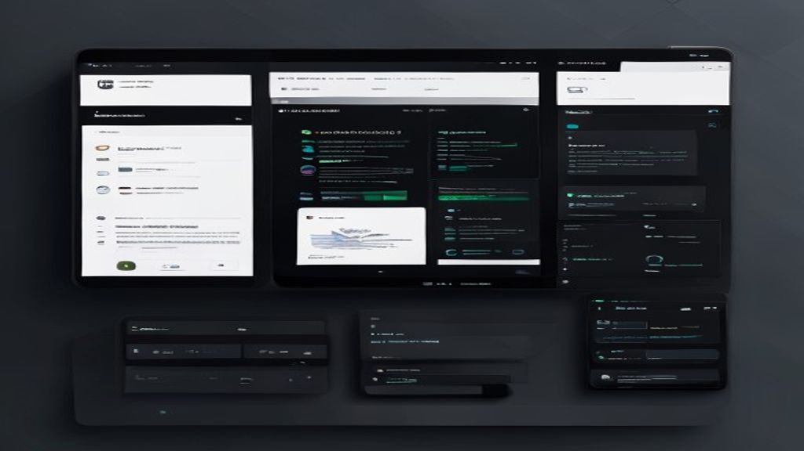

# LocalCodingAssistant

## How it Works

The system runs a locally hosted LLM (e.g., Mistral 7B) that assists developers with code completion, debugging, and documentation generation. The workflow includes:
1. Environment initialization via a virtual environment.
2. Loading of the LLM and tokenizer.
3. Real‑time interaction through a lightweight CLI or VS Code extension.
4. Persistent caching of model weights to avoid repeated downloads.

## Architecture

```mermaid
flowchart TD
    A[Developer] -->|Issue Query| B[CLI / VS Code Extension]
    B -->|Send Prompt| C[Local LLM (Mistral 7B)]
    C -->|Generate Response| D[Response Sent Back]
    D -->|Display| A
    style A fill:#f9f,stroke:#333
    style B fill:#bbf,stroke:#333
    style C fill:#bfb,stroke:#333
    style D fill:#fbb,stroke:#333
```



## Setup

Run the provided Windows batch script to create a virtual environment, install dependencies, and execute tests.

## Testing

The test suite validates model loading, inference speed, and basic code‑completion functionality.

---

## License

MIT
