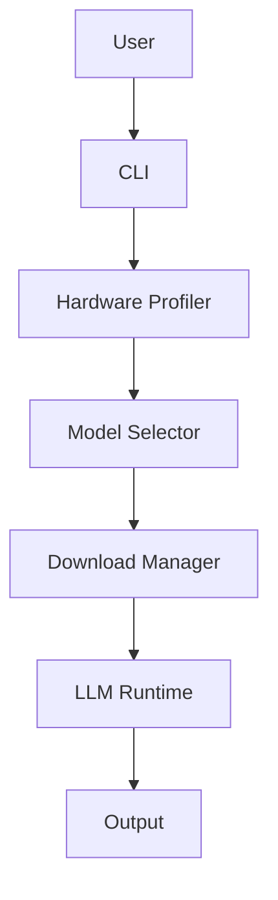
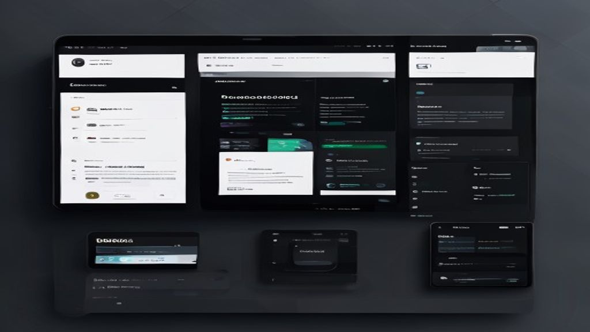

# LocalLLM Optimizer

## How it Works
The optimizer analyzes your local machine’s CPU, GPU, memory, and disk characteristics to recommend the most suitable LLM model and configuration for your workload. It then automatically downloads the selected model, sets up the environment, and provides a simple CLI to run inference.

## Architecture

## App Preview

