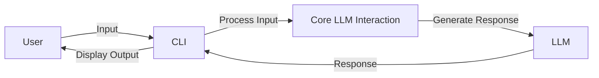

# LocalLLMChat

## Vision
LocalLLMChat is a local, lightweight, and efficient chat application powered by a local LLM (Language Model). The application is designed to run on consumer hardware and provides a command-line interface (CLI) for users to interact with the LLM. The focus is on efficiency and minimal resource usage.

## Architecture
The architecture of LocalLLMChat is designed to be modular and maintainable. Here's a high-level overview:

- **Project Structure**: The project is organized into modules for better separation of concerns.
- **Core LLM Interaction**: This module handles the interaction with the local LLM, including loading the model and processing user inputs.
- **CLI**: The CLI module provides a user-friendly interface for interacting with the LLM.
- **Unit Tests**: Comprehensive unit tests cover all core functionalities, ensuring the application works as expected.

### How it Works
1. **User Input**: The user interacts with the application via the CLI, providing input in the form of text.
2. **Input Processing**: The input is processed and passed to the LLM.
3. **LLM Response**: The LLM generates a response based on the input.
4. **Output Display**: The response is displayed back to the user via the CLI.



## Setup and Installation
To set up and run LocalLLMChat, follow these steps:

### Prerequisites
- Python 3.8 or higher
- `pip` for package management

### Installation
1. Clone the repository:
   ```sh
   git clone https://github.com/your-repo/LocalLLMChat.git
   cd LocalLLMChat
   ```

2. Install the required dependencies:
   ```sh
   pip install -r requirements.txt
   ```

3. Set up the local LLM (if not already done):
   ```sh
   python setup_llm.py
   ```

### Running the Application
To start the application, run:
```sh
python -m local_llm_chat
```

You will see a prompt where you can enter your text. The LLM will process your input and provide a response.

## Testing
To run the unit tests, use:
```sh
pytest
```

This will execute all the unit tests and provide a report on the test results.

## Contributing
Contributions are welcome! Please read the [CONTRIBUTING.md](CONTRIBUTING.md) file for more details.

## License
This project is licensed under the MIT License. See the [LICENSE](LICENSE) file for details.