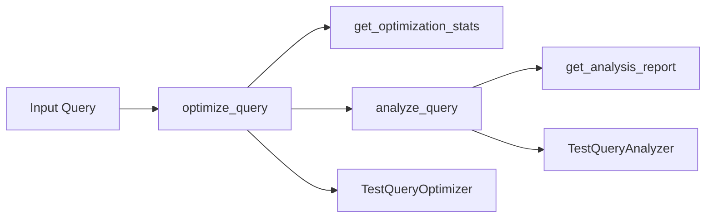

# LocalLLMQueryOptimizer

## Overview
LocalLLMQueryOptimizer is a Python project designed to optimize queries for local Large Language Models (LLMs), enhancing their performance and efficiency on consumer hardware. The project includes a suite of tools for query optimization, analysis, and testing.

## Architecture
The project is structured into several key components:
- **optimizer.py**: Contains the core logic for optimizing queries.
- **query_analyzer.py**: Provides functions to analyze and report on the structure of queries.
- **test_main.py**: A test suite to ensure the functionality and correctness of the optimizer and analyzer.
- **.gitignore**: Configuration to ignore unnecessary files in version control.

### How it Works
1. **Query Optimization**:
   - **Token Reduction**: Removes stop words from the query.
   - **Keyword Normalization**: Standardizes keywords to a consistent format.
   - **Redundant Clause Removal**: Eliminates duplicate tokens to reduce redundancy.

2. **Query Analysis**:
   - **Token Counting**: Counts the total number of tokens in the query.
   - **Unique Keywords**: Identifies and counts unique keywords.
   - **Pattern Detection**: Detects and counts specific patterns like emails and URLs.

3. **Testing**:
   - **Unit Tests**: Comprehensive tests to validate the functionality of the optimizer and analyzer.

## Setup
To set up the project, follow these steps:

1. Clone the repository:
   ```sh
   git clone https://github.com/your-repo/LocalLLMQueryOptimizer.git
   cd LocalLLMQueryOptimizer
   ```

2. Create a virtual environment and install the dependencies:
   ```sh
   python -m venv venv
   source venv/bin/activate  # On Windows use `venv\Scripts\activate`
   pip install -r requirements.txt
   ```

## Running the Tests
To run the tests, use the following command:
```sh
python -m unittest discover -s tests
```

## Mermaid Diagram


## Contributing
Contributions are welcome! Please read the [contribution guidelines](CONTRIBUTING.md) before submitting a pull request.

## License
This project is licensed under the MIT License. See the [LICENSE](LICENSE) file for details.