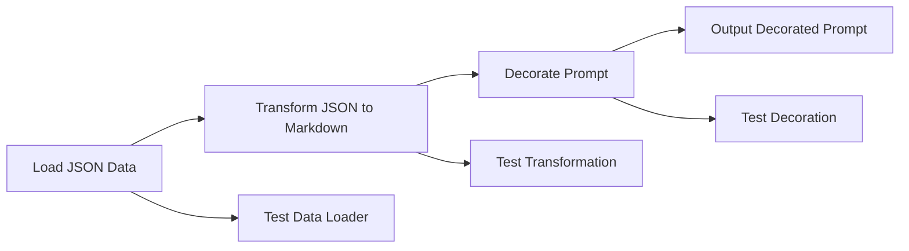

# PromptDecorator

## Overview
PromptDecorator is a Python application designed to transform structured data (JSON) into markdown and decorate it at prompt-time. This project aims to provide a compact, efficient, and cross-platform solution with a focus on pure functions and dependency injection for easy testing.

## Architecture
The project is structured as follows:
- **prompt_decorator.py**: Contains the core functions `transform_json_to_markdown` and `decorate_prompt`.
- **data_loader.py**: Provides the `load_json_data` function to load JSON data from a file.
- **test_main.py**: Contains the test cases for the core functions.
- **.gitignore**: Specifies files and directories to be ignored by Git.

### How it Works
1. **Data Loading**: The `load_json_data` function in `data_loader.py` loads JSON data from a specified file path.
2. **Transformation**: The `transform_json_to_markdown` function in `prompt_decorator.py` converts the loaded JSON data into a markdown string.
3. **Decoration**: The `decorate_prompt` function in `prompt_decorator.py` adds additional information to the prompt string.
4. **Testing**: The `TestPromptDecorator` class in `test_main.py` contains unit tests to ensure the correctness of the transformation and decoration functions.

## Setup
To set up the environment, follow these steps:

1. Clone the repository:
   ```sh
   git clone https://github.com/your-username/prompt-decorator.git
   cd prompt-dectorator
   ```

2. Create a virtual environment and activate it:
   ```sh
   python -m venv venv
   source venv/bin/activate  # On Windows use `venv\Scripts\activate`
   ```

3. Install the required dependencies:
   ```sh
   pip install -r requirements.txt
   ```

## Running Tests
To run the tests, use the following command:
```sh
python -m unittest discover -s tests
```

## Mermaid Diagram


## Contributing
Contributions are welcome! Please read the [contribution guidelines](CONTRIBUTING.md) before submitting a pull request.

## License
This project is licensed under the MIT License. See the [LICENSE](LICENSE) file for details.