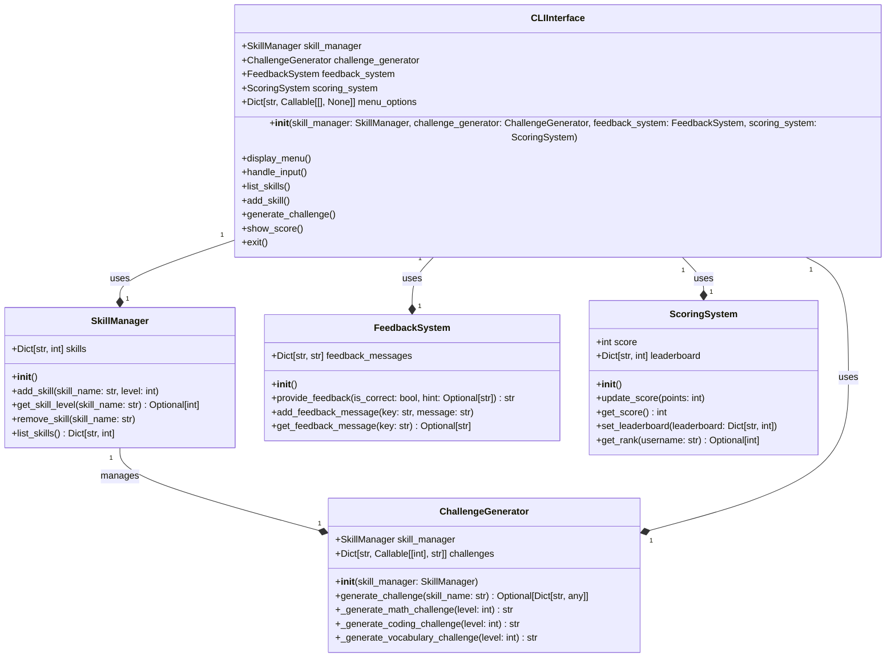

# SkillGrowthAgent

## Overview
SkillGrowthAgent is a gamified learning system designed to help users improve and maintain their skills. It leverages AI to provide personalized feedback and challenges, making the learning process engaging and effective.

## Architecture
The SkillGrowthAgent is built with a modular architecture, where each component has a specific responsibility. The main components are:

- **SkillManager**: Manages user skills and their levels.
- **ChallengeGenerator**: Generates challenges based on the user's skill level.
- **FeedbackSystem**: Provides feedback to the user based on their responses.
- **ScoringSystem**: Tracks and updates the user's score and rank.
- **CLIInterface**: Handles the command-line interface for user interactions.

### How it Works
1. **Skill Management**:
   - Users can add, update, and remove skills using the `SkillManager`.
   - The `SkillManager` stores and retrieves skill information.

2. **Challenge Generation**:
   - Based on the user's skill level, the `ChallengeGenerator` generates appropriate challenges.
   - Challenges are generated for different skill types (e.g., math, coding, vocabulary).

3. **User Interaction**:
   - The `CLIInterface` provides a menu-driven interface for users to interact with the system.
   - Users can list skills, add new skills, generate challenges, and view their scores.

4. **Feedback and Scoring**:
   - After attempting a challenge, the `FeedbackSystem` provides feedback to the user.
   - The `ScoringSystem` updates the user's score based on their performance.

5. **Testing**:
   - Unit tests, integration tests, and end-to-end tests ensure the reliability and correctness of the system.

### File Structure
- **skill_manager.py**: Contains the `SkillManager` class.
- **challenge_generator.py**: Contains the `ChallengeGenerator` class.
- **feedback_system.py**: Contains the `FeedbackSystem` class.
- **scoring_system.py**: Contains the `ScoringSystem` class.
- **cli_interface.py**: Contains the `CLIInterface` class.
- **test_main.py**: Contains the test cases for the SkillGrowthAgent.

### Class Diagram


### Running the Tests
To run the tests, use the following command:
```sh
python -m unittest test_main.py
```

This will execute all the test cases defined in `test_main.py`, ensuring that the SkillGrowthAgent functions as expected.