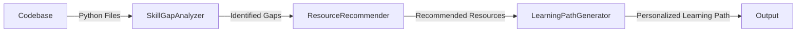

# SkillGrowthAgent

## Overview
SkillGrowthAgent is a specialized tool designed to help developers identify and fill gaps in their skill sets by analyzing their codebase and suggesting learning resources. The agent provides a personalized learning path based on the developer's current projects and skills.

## Architecture


### Components
- **SkillGapAnalyzer**: Analyzes the codebase to identify the skills present and compares them with a predefined skill profile to find gaps.
- **ResourceRecommender**: Recommends learning resources based on the identified skill gaps.
- **LearningPathGenerator**: Generates a structured and personalized learning path from the recommended resources.

## Installation
1. Clone the repository:
   ```bash
   git clone https://github.com/yourusername/SkillGrowthAgent.git
   cd SkillGrowthAgent
   ```

2. Create and activate a virtual environment (optional but recommended):
   ```bash
   python -m venv venv
   source venv/bin/activate  # On Windows, use `venv\Scripts\activate`
   ```

3. Install the required dependencies:
   ```bash
   pip install -r requirements.txt
   ```

## Usage
### Step-by-Step Guide
1. **Prepare the Skill Profile**:
   - Create a JSON file (e.g., `skill_profile.json`) that defines the required skills for different categories. For example:
     ```json
     {
         "Python": ["ast", "unittest"],
         "Web Development": ["Django", "Flask"]
     }
     ```

2. **Run the SkillGapAnalyzer**:
   - Use the `SkillGapAnalyzer` to analyze your codebase and identify skill gaps.
   ```python
   from skillgap_analyzer import SkillGapAnalyzer, load_skill_profile

   skill_profile = load_skill_profile('skill_profile.json')
   analyzer = SkillGapAnalyzer(skill_profile)
   skill_gaps = analyzer.identify_skill_gaps('/path/to/your/codebase')
   print(skill_gaps)
   ```

3. **Get Resource Recommendations**:
   - Use the `ResourceRecommender` to get learning resources based on the identified skill gaps.
   ```python
   from resource_recommender import recommend_resources

   recommended_resources = recommend_resources(skill_gaps)
   print(recommended_resources)
   ```

4. **Generate a Personalized Learning Path**:
   - Use the `LearningPathGenerator` to create a structured learning path from the recommended resources.
   ```python
   from learning_path_generator import generate_learning_path, save_learning_path

   learning_path = generate_learning_path(recommended_resources)
   save_learning_path(learning_path, 'learning_path.json')
   ```

5. **Review the Learning Path**:
   - Open the generated `learning_path.json` file to see your personalized learning path.

## How It Works
1. **SkillGapAnalyzer**:
   - The `SkillGapAnalyzer` class analyzes the given codebase by parsing Python files and extracting used libraries and modules.
   - It compares the extracted skills with the predefined skill profile to identify any gaps.

2. **ResourceRecommender**:
   - The `ResourceRecommender` class recommends learning resources based on the identified skill gaps.
   - It uses a predefined resource database to suggest books, websites, and other materials that can help fill the gaps.

3. **LearningPathGenerator**:
   - The `LearningPathGenerator` class generates a structured and personalized learning path from the recommended resources.
   - It organizes the resources into a step-by-step plan, prioritizing books over websites for a more focused learning experience.

## Testing
- The project includes a comprehensive testing strategy with unit tests for core logic and integration tests for the entire pipeline.
- To run the tests, use the following command:
  ```bash
  python -m unittest discover -s tests
  ```

## Contributing
- Contributions are welcome! Please read the [CONTRIBUTING.md](CONTRIBUTING.md) for details on how to contribute to this project.

## License
- This project is licensed under the MIT License. See the [LICENSE](LICENSE) file for details.