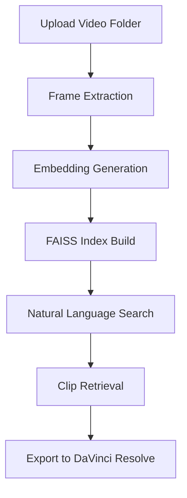

# VideoMoments Indexer

A local, privacy‑first tool that indexes personal video libraries (e.g., GoPro footage) using open‑source multimodal models, enabling instant search for highlight moments and direct export to DaVinci Resolve timelines.

## How it Works

1. **Ingest** – Scan a directory of video files and extract key frames.
2. **Embed** – Run a lightweight CLIP‑based model to generate embeddings for each frame.
3. **Store** – Persist embeddings in a FAISS index for fast similarity search.
4. **Query** – Users type natural‑language queries; the system retrieves the most relevant moments.
5. **Export** – Selected clips are trimmed and saved as MP4 files ready for DaVinci Resolve.

## Setup

Run the provided batch script to create a virtual environment, install dependencies, and execute the test suite.

## Future Work

- Support multi‑modal queries (audio, text, metadata)
- Integrate with popular NLEs via plugins
- Optimize for multi‑GPU setups
